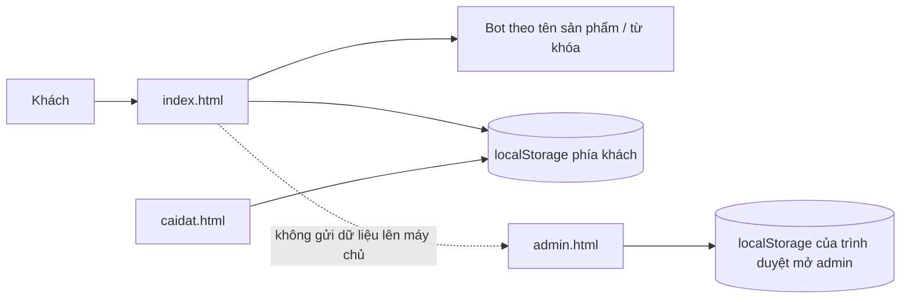
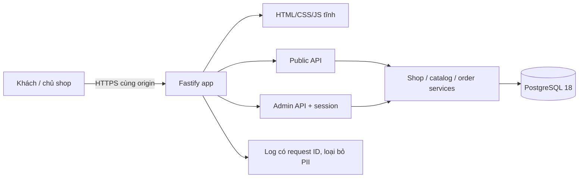

# Kiến trúc Mino

**Trạng thái:** kiến trúc đích đề xuất cho M1; chưa được triển khai. Sơ đồ hiện tại mô tả mã đang có.

## 1. Hiện trạng (as-is)



- Chỉ có HTML, CSS và JavaScript nhúng trong bốn trang; không backend, database, auth hoặc build.
- Form đơn lưu tại trình duyệt gửi form. Admin có dữ liệu mẫu và có thể đọc localStorage nếu cùng browser profile/origin; không truy cập được storage của khách khác.
- Các mẫu mã Messenger/Zalo trong hướng dẫn chưa được kết nối vào ứng dụng.

## 2. Đích M1 (to-be)



Một tiến trình ứng dụng phục vụ file tĩnh và API dưới cùng origin (`/` và `/api/v1/*`). Cách này giảm nhu cầu CORS và đơn giản hóa cookie phiên. PostgreSQL là nguồn dữ liệu chính; `localStorage` không còn là nguồn cho đơn, sản phẩm hoặc cài đặt.

## 3. Stack đề xuất

| Lớp | Lựa chọn M1 | Lý do / giới hạn |
|---|---|---|
| Runtime | Node.js 26 LTS | Dùng nhánh LTS cho production; kiểm tra trạng thái hỗ trợ tại lúc tạo máy. [Node.js release schedule](https://nodejs.org/en/about/previous-releases) |
| Ngôn ngữ | TypeScript, strict | Chia sẻ kiểu dữ liệu trong API; kiểu không thay thế validation runtime. |
| HTTP | Fastify | Route schema kiểm tra request và có thể định nghĩa schema response. [Fastify validation](https://fastify.dev/docs/latest/Reference/Validation-and-Serialization/) |
| Database | PostgreSQL 18 (mặc định bảo thủ) | Quan hệ/transaction phù hợp cho đơn; 18 được hỗ trợ tới 14-11-2030. PostgreSQL 19 đã phát hành ngày 19-11-2026, nên kiểm tra host ở M0; nếu host hỗ trợ 19 ổn định, có thể chọn 19 thay vì 18. [Versioning policy](https://www.postgresql.org/support/versioning/) · [PostgreSQL FAQ](https://www.postgresql.org/about/press/faq/) |
| DB schema/migration | Prisma ORM, migration files được commit | Không sửa migration đã chạy ở staging/prod; dùng lệnh deploy phù hợp major đang cài. [Prisma Migrate](https://www.prisma.io/docs/orm/prisma-migrate) |
| UI | Giữ HTML/CSS/JS hiện có; tách asset theo nhu cầu | Tránh viết lại giao diện trước khi có yêu cầu; bổ sung API và trạng thái loading/error. |
| Deploy | Một ứng dụng web + một PostgreSQL managed hoặc self-hosted | Nhà cung cấp/khu vực/chi phí chưa chốt; cần backup và HTTPS. |

Các phiên bản nêu trên được rà ngày 26-11-2026. Trước khi khởi tạo dự án, kiểm tra lại LTS và phiên bản database được host hỗ trợ; không dùng nhánh runtime EOL.

## 4. Ranh giới module

M1 dùng modular monolith: một tiến trình, module tách theo nghiệp vụ, không gọi vòng qua nhau bằng HTTP nội bộ.

```text
public/                 4 trang hiện tại và assets
src/
  app.ts                tạo server, đăng ký plugin/route
  config/               đọc/kiểm tra environment
  plugins/              database, session, rate limit, logging
  modules/
    auth/               login, logout, session guard
    shop/               cấu hình public/admin
    products/           catalog và CRUD
    bot-rules/           từ khóa/fallback
    orders/              tạo COD, query, state transition
    audit/               sự kiện quản trị
  shared/                lỗi chuẩn, phân trang, helpers
prisma/                  schema và migration
docs/                    PRD, kiến trúc, API, runbook
```

Không tạo queue/service riêng ở M1. Khi M2/M3 cần webhook retry, thêm outbox/worker nhỏ trước; chỉ tách service khi có yêu cầu vận hành đo được.

## 5. Ranh giới bảo mật

- Public API chỉ đọc thông tin public và tạo đơn. Không nhận giá hoặc tổng tiền có thẩm quyền từ browser.
- Admin API luôn lấy `shop_id` từ session ở server; không lấy tenant scope từ query/body.
- Login cấp cookie opaque `HttpOnly`; server lưu hash session token, hết hạn và có thể thu hồi. Không lưu bearer token trong localStorage.
- Với API thay đổi dữ liệu: xác minh phiên, origin/CSRF, schema và quyền trước nghiệp vụ.
- Trình duyệt chỉ nhận trường cần hiển thị; password hash, session secret, provider token không bao giờ trả ra.
- Toàn bộ giao tiếp production qua HTTPS; secrets ở environment/secret manager, không trong source map hoặc frontend.

## 6. Luồng tạo đơn

1. UI gửi `productId`, `quantity`, thông tin người nhận và `Idempotency-Key`.
2. Fastify xác thực JSON theo schema, giới hạn body và từ chối trường ngoài hợp đồng.
3. Order service đọc sản phẩm thuộc shop và trạng thái bán hiện tại từ DB.
4. Server tính tiền từ giá DB; tạo `orders`, `order_items` snapshot và `order_events` trong một transaction.
5. Unique `(shop_id, idempotency_key)` xử lý double-click/retry. Cùng key + cùng fingerprint trả lại kết quả cũ; khác fingerprint trả 409.
6. UI chỉ hiển thị thành công sau khi DB commit và API trả order number.

## 7. Luồng chat (M2, chưa làm ở M1)

Anonymous visitor có mã phiên ngẫu nhiên khó đoán; server lưu hash/expiry, scope mọi request vào phiên đó. Tin nhắn, bot reply và admin reply cùng lưu trong DB. Admin luôn xác thực; visitor chỉ truy cập session của mình. Ban đầu dùng polling có cursor; chỉ thêm WebSocket/SSE nếu độ trễ polling là vấn đề thật.

## 8. Luồng kênh ngoài (M3, chưa làm ở M1)

Provider webhook → verify signature/challenge → ghi event idempotent → channel adapter chuẩn hóa event → conversation service → database. Outbound message qua adapter với timeout/retry giới hạn. Provider token chỉ có backend đọc; webhook/event lỗi có hàng đợi hoặc bảng retry, không phụ thuộc request webhook đang mở.

## 9. Quy tắc thiết kế

- Tiền DB lưu đơn vị VND nguyên, không dùng float. API trả số tiền dưới dạng chuỗi số nguyên (`"125000"`) để tránh mất chính xác ở JavaScript.
- Timestamp DB là UTC; UI định dạng `Asia/Ho_Chi_Minh`.
- Giữ snapshot tên/giá trên dòng đơn, kể cả khi sản phẩm đổi/xóa sau đó.
- Soft-hide sản phẩm đã bán; không xóa cứng bản ghi còn được tham chiếu bởi đơn.
- Không thêm multi-tenant user invitations, thanh toán, AI hay queue vào M1.

## 10. Tài liệu liên quan

- [Yêu cầu sản phẩm](PRODUCT_REQUIREMENTS.md)
- [Kế hoạch triển khai](IMPLEMENTATION_PLAN.md)
- [Thiết kế dữ liệu](DATA_MODEL.md)
- [Hợp đồng API](API_CONTRACT.md)
- [Bảo mật](SECURITY.md)
- [Vận hành/phát hành](OPERATIONS.md)
