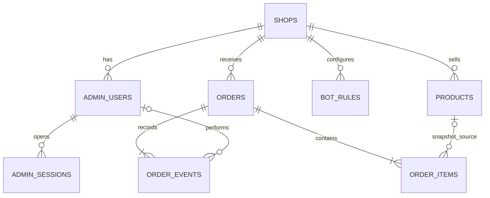

# Thiết kế dữ liệu Mino

**Trạng thái:** đề xuất cho M1. Các bảng chưa được tạo. Schema/migration trong mã nguồn là nguồn sự thật sau khi triển khai.

## Nguyên tắc

- PostgreSQL; khóa chính UUID; `created_at`/`updated_at` lưu UTC.
- Mọi bảng nghiệp vụ có `shop_id`; API lấy scope từ phiên admin, không từ request body.
- Tiền VND là số nguyên, lưu `BIGINT`; API serialize thành chuỗi số nguyên.
- Đơn và item dùng snapshot để lịch sử không đổi khi giá/tên sản phẩm thay đổi.
- PII chỉ lưu trường cần giao hàng; không tạo CRM/customer profile ở M1 nếu chưa cần.
- FK không cascade xóa đơn; dùng `active/hidden/archived` thay vì xóa product đã được đặt.

## Quan hệ

## Tables M1

### `shops`

| Field | Type | Rules |
|---|---|---|
| `id` | UUID | PK |
| `name` | text | required, max 120 |
| `public_phone` | text nullable | public only if shop chooses |
| `public_address` | text nullable | optional |
| `timezone` | text | default `Asia/Ho_Chi_Minh` |
| `currency` | char(3) | M1 fixed `VND` |
| `bot_name` | text | required, max 60 |
| `fallback_reply` | text | required, max 1000 |
| `created_at`, `updated_at` | timestamptz | required |

M1 seed tạo đúng một shop. Không có API tạo shop trong M1.

### `admin_users`

`id UUID PK`, `shop_id UUID FK`, `email_normalized text`, `password_hash text`, `status active|disabled`, `last_login_at timestamptz nullable`, timestamps. Unique `(shop_id, email_normalized)`. Không lưu password rõ, reset token hoặc mật khẩu mặc định.

### `admin_sessions`

`id UUID PK`, `admin_user_id UUID FK`, `session_token_hash bytea unique`, `csrf_token_hash bytea`, `created_at`, `last_seen_at`, `expires_at`, `revoked_at nullable`. Cookie chỉ mang token ngẫu nhiên; DB chỉ lưu hash. Thu hồi session khi logout, đổi mật khẩu hoặc disable user.

### `products`

`id UUID PK`, `shop_id UUID FK`, `name text`, `description text nullable`, `price_vnd bigint CHECK(price_vnd >= 0)`, `emoji text nullable`, `status active|hidden|archived`, timestamps. Index `(shop_id,status,name)`. M1 chưa quản lý tồn kho; bot không được trả lời “còn hàng” nếu không có nguồn stock thật.

### `bot_rules`

`id UUID PK`, `shop_id UUID FK`, `keywords text[]`, `answer text`, `priority integer`, `enabled boolean`, timestamps. Cần ít nhất một keyword không rỗng và answer không rỗng. Index `(shop_id,enabled,priority)`. Matching: lowercase/trim Unicode; priority tăng dần; tie-break theo `id` để kết quả ổn định. Chỉ trả giá từ catalog API.

### `orders`

| Field | Type | Rules |
|---|---|---|
| `id` | UUID | PK |
| `shop_id` | UUID FK | required |
| `order_no` | text | unique per shop, không tuần tự dễ đoán |
| `status` | enum/text | `new`, `confirmed`, `preparing`, `shipping`, `completed`, `cancelled` |
| `recipient_name` | text | required, max 120 |
| `recipient_phone` | text | required; preserve display form; normalize separately for search if needed |
| `shipping_address` | text | required, max 500 |
| `customer_note` | text nullable | max 1000 |
| `subtotal_vnd` | bigint | server calculated, >= 0 |
| `shipping_fee_vnd` | bigint nullable | null until shop confirms; no automatic calculation |
| `total_vnd` | bigint nullable | null until confirmation; then server calculated as subtotal + shipping |
| `idempotency_key` | text | required; unique per shop |
| `request_fingerprint` | bytea | hash of canonical validated request |
| `created_at`, `updated_at` | timestamptz | required |

Index `(shop_id,created_at DESC)` và `(shop_id,status,created_at DESC)`. Không trả `idempotency_key`/fingerprint cho admin/client.

### `order_items`

`id UUID PK`, `shop_id UUID`, `order_id UUID FK`, `product_id UUID nullable FK`, `product_name_snapshot text`, `unit_price_vnd bigint`, `quantity integer CHECK(quantity BETWEEN 1 AND 1000)`, `line_total_vnd bigint`. FK/order ownership phải cùng shop. `line_total = unit_price * quantity` kiểm tra trong service/transaction.

### `order_events`

`id UUID PK`, `shop_id UUID`, `order_id UUID FK`, `actor_admin_user_id UUID nullable FK`, `event_type text`, `old_status text nullable`, `new_status text nullable`, `note text nullable`, `created_at timestamptz`. Chỉ ghi thay đổi trạng thái hoặc thao tác quan trọng; không ghi address/phone vào event.

## M2/M3 tables — chưa tạo ở M1

### `chat_sessions` / `messages`

- Session: `id`, `shop_id`, `channel web|provider`, `visitor_token_hash nullable`, `status`, `last_message_at`, timestamps, `closed_at`.
- Message: `id`, `shop_id`, `chat_session_id`, `sender customer|bot|admin|system`, `body text`, `provider_message_id nullable`, `created_at`, `delivery_status`.
- Unique `(shop_id,channel,provider_message_id)` khi provider ID có giá trị; giới hạn nội dung/retention.
- Internal notes nên là event/note riêng; không lưu chung như tin nhắn gửi khách.

### `webhook_events` / `integrations`

- `integrations`: shop, provider, external account ID, trạng thái, secret reference; token không lưu plaintext trong DB/log/frontend.
- `webhook_events`: provider event ID unique, payload tối thiểu hoặc encrypted/quarantine, nhận lúc nào, trạng thái xử lý, retry count, error code đã làm sạch.

## Ràng buộc giao dịch và xóa

- Tạo order + items + initial event trong một transaction.
- Đơn `new` giữ `shipping_fee_vnd`/`total_vnd` null; chuyển `new → confirmed` phải nhập phí ship, tính tổng trong transaction và ghi event.
- Cập nhật order status + event trong một transaction.
- Tính subtotal từ `unit_price_vnd * quantity` đã được DB xác nhận.
- Không hard-delete shop/admin/product/order qua CRUD thông thường. Dùng archive/disable và quy trình xóa riêng có kiểm tra phụ thuộc.
- Chủ dự án phải xác định thời hạn lưu PII trước production; không gán retention theo suy đoán trong code.
